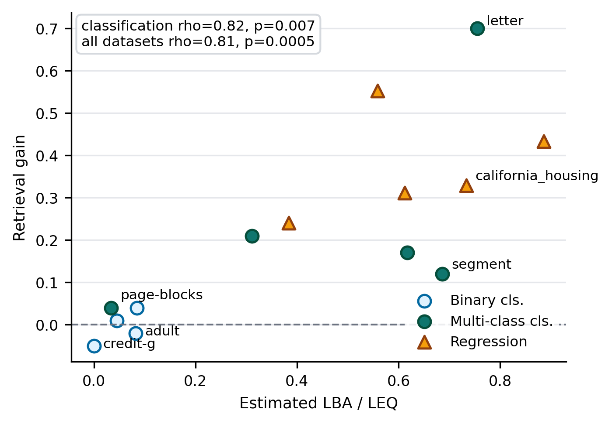

# Local Bayes Advantage for Tabular In-Context Learning

Official code and main-result artifacts for **Local Bayes Advantage for Selective Retrieval in Tabular In-Context Learning**.

This repository studies when retrieved demonstrations help a frozen language model on tabular prediction. It implements Local Bayes Advantage (LBA), matched-pair boundary retrieval, and validation-selected selective retrieval.



## What is included

- `rail/`: data loading, tabular serialization, LLM backends, retrieval methods, baselines, and evaluation.
- `configs/datasets.yaml`: the 14 public OpenML datasets used in the paper.
- `artifacts/results/`: only the result files supporting the paper's main analyses.
- `artifacts/figures/` and `artifacts/tables/`: main generated paper artifacts.
- `tests/`: API-free unit tests for the core implementation.

Exploratory results, request logs, caches, draft manuscripts, and local environment files are intentionally excluded.

## Installation

Python 3.12 and [uv](https://docs.astral.sh/uv/) are recommended.

```bash
git clone https://github.com/yueyangming/lba-tabular-icl.git
cd lba-tabular-icl
uv sync --frozen
```

Modern tabular baselines require additional packages:

```bash
uv sync --frozen --extra modern-baselines
```

## Reproduce the released figures and tables

This step is offline: it does not download datasets or call an LLM API.

```bash
uv run lba-build-artifacts
```

The command reads the frozen main results in `artifacts/results/` and regenerates the primary figures and tables. See [docs/RESULTS.md](docs/RESULTS.md) for the complete artifact map.

## Run an API-free baseline

The dataset is downloaded from OpenML on first use.

```bash
uv run python -m rail.experiments.run_smoke \
  --dataset diabetes \
  --output outputs/smoke_diabetes.csv
```

## Run a small LLM experiment

Copy `.env.example` to `.env`, add your own provider key, and keep `.env` private. API calls may incur cost.

```bash
uv run lba-icl \
  --dataset letter \
  --dataset-id 6 \
  --model latest \
  --k 100 \
  --max-examples 5 \
  --selection-strategy matched_pair_boundary \
  --output outputs/letter_smoke.csv \
  --request-log outputs/logs/letter_smoke.jsonl
```

Hosted models and APIs can change over time, so fresh runs are not expected to be bit-for-bit identical to the frozen results. Exact dataset IDs, split rules, seeds, prompts, and decoding behavior are included for auditability.

## Tests

```bash
uv run pytest
```

The test suite uses local mock backends and does not require an API key.

## Documentation

- [Reproducibility guide](docs/REPRODUCIBILITY.md)
- [Main-result manifest](docs/RESULTS.md)
- [Dataset provenance](docs/DATASETS.md)

## Citation

Citation metadata is provided in [`CITATION.cff`](CITATION.cff).
